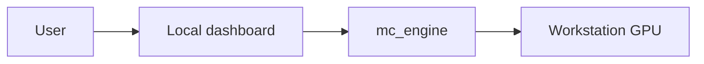
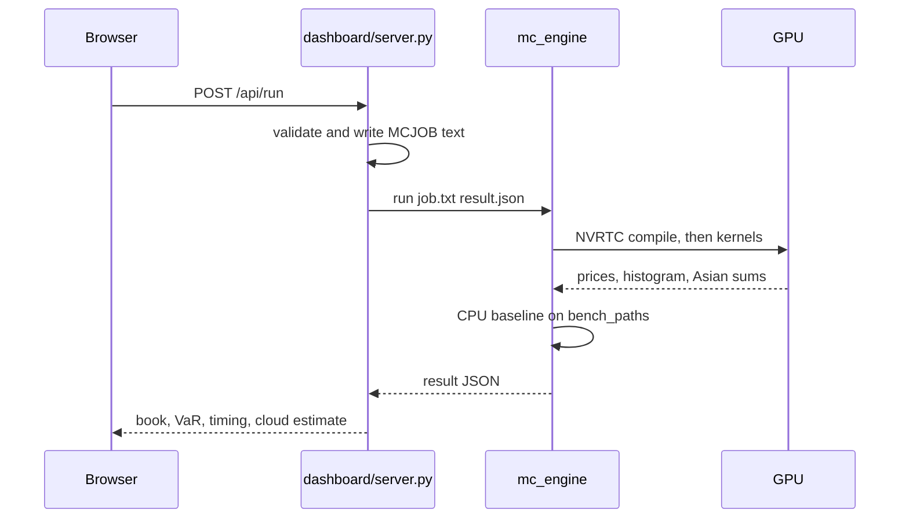

# Architecture

This repository is a local Monte Carlo risk engine. A user submits a small portfolio. Custom CUDA kernels price the options, then revalue the whole book on tens or hundreds of millions of correlated scenarios, and return Value-at-Risk, expected shortfall, and a speed comparison against a multi-threaded CPU. The run that exists is the dashboard on `127.0.0.1:8765` calling `mc_engine` on the workstation GPU. No model is trained.

## What problem it solves

A risk number for a mixed book is not a single formula. Equities move together, option values change with the new spot and the time left to expiry, and the loss that matters is in the tail, not the average. Closed-form Black-Scholes prices each European option once. It does not price a path-dependent Asian, and it does not give the distribution of a portfolio whose names are correlated.

Monte Carlo does both, if you can run enough paths. One hundred million scenarios is enough to make the 99% tail stable, and it is too much work for a straightforward CPU loop if the answer is wanted in seconds. The engine puts that loop in CUDA kernels written for this book and measures the speedup against its own CPU implementation. That measurement was done on the local GPU.

## Synthetic dataset

The sample book is synthetic. Every spot, volatility, dividend, rate, drift, correlation entry, and position is a constant in `sample_portfolio()` in `common/jobtext.py`. No price file was downloaded. No exchange or vendor feed is called. No parameter was fitted or trained. SPX, AAPL, XOM, and GLD are labels. The numbers are not live quotes.

| Name | Spot | Vol | Rate | Dividend | Drift |
| --- | --- | --- | --- | --- | --- |
| SPX | 5200 | 0.16 | 0.045 | 0.013 | 0.032 |
| AAPL | 190 | 0.28 | 0.045 | 0.005 | 0.040 |
| XOM | 110 | 0.22 | 0.045 | 0.032 | 0.013 |
| GLD | 180 | 0.14 | 0.045 | 0 | 0.045 |

Positions: long 8 SPX, short 4 SPX puts struck at 5000 expiring in 0.25y, long 30 AAPL 200 calls and 20 AAPL 170 puts expiring in 0.50y, long 40 XOM and 25 GLD. Correlation is moderate between SPX and AAPL (0.55), weaker between the others, and near zero between SPX and GLD. Seed 42. The Asian is a 1-year AAPL 190 call averaged over 32 steps, quantity 1. The dashboard loads this book. Numbers typed over it are still hand inputs, not a market feed.

## What the system is

One runtime was built and run. The browser talks to the local server, and the server talks to the engine.

| Piece | Role |
| --- | --- |
| `dashboard/index.html` | Book form, histogram, speed bars, and a cloud-cost estimate |
| `dashboard/server.py` | Validates the book and runs the local engine on `127.0.0.1:8765` |
| `common/jobtext.py` | Checks limits and writes the `MCJOB 1` text the engine reads |
| `src/engine.c` | Loads the GPU driver, compiles the kernels, runs the CPU baseline, writes JSON |
| `kernels/mc_risk.cu` | Philox RNG, European pricing, scenario revaluation, VaR histogram, Asian control variate |
| `aws/handler.py` | Lambda source. Not deployed |
| `aws/template.yaml` | SAM template for an HTTP API, a bucket, and spot Batch. Not deployed |
| `docker/` | Dockerfile and entrypoint. The image was not built |

The local server binds to `127.0.0.1` only. The AWS and Docker files are in the repository and were not executed.

## How a job runs locally

1. The browser loads the sample book from `GET /api/sample` or edits spots, vols, correlation, and positions.
2. `POST /api/run` sends JSON. `jobtext.validate` rejects a book that fails the limits below.
3. The server writes `tmp/job_<id>.txt` and runs `build/mc_engine.exe run <job> <result>`.
4. The engine finds `kernels/mc_risk.cu` beside the repository, or from `MC_KERNEL`.
5. NVRTC compiles that source for the installed GPU. The cubin or PTX is cached next to the executable.
6. Kernels price the book, build the P&L histogram, and price the Asian if one was requested.
7. A smaller matched run on the CPU produces the speedup. The JSON goes back to the page.

Paths are resolved from the process, not from a fixed drive. `build.ps1` uses its own directory as the repository root, searches for a 64-bit `gcc` (`CC`, then `PATH`, then a toolchain directory on a local drive), and installs the NVRTC wheel into `.cuda_pkgs` only when no `nvrtc64_*.dll` is already there. The engine then searches that tree, `NVRTC_PATH`, and `CUDA_PATH\bin`.

## The numerical method

Prices follow geometric Brownian motion. One trading day is `1/252` of a year. The sample book sets each name's drift to rate minus dividend, so the equity step is risk-neutral. A caller can pass another drift.

European prices use antithetic pairs: each normal `z` is also run as `-z`, and the two discounted payoffs are averaged. That cuts the variance of the mean price. The same normals are not reused for the VaR sample. VaR wants an ordinary sample of scenarios, not a symmetrized one.

Portfolio scenarios take one Philox draw per name, multiply by the Cholesky factor of the correlation matrix, and step every spot to the horizon. The book is then revalued in full. Equities are marked at the simulated spot. Calls and puts are Black-Scholes with the remaining maturity. The profit and loss is that future value, discounted, minus the value at the start.

Value-at-Risk is the loss at the 95% and 99% quantiles of that P&L. Expected shortfall is the average P&L inside the tail. Both are read from a histogram of 4096 bins. The dashboard draws 128 of those bins. Paths that fall outside the bin range are counted as under and over, so a clipped tail is visible instead of being dropped. Storing every path would grow with the scenario count. The histogram does not.

The Asian is separate from the portfolio VaR. It is an arithmetic average-price call. A geometric Asian has a closed form (Kemna-Vorst) and is simulated on the same paths, then used as a control variate for the arithmetic price. The engine also reports the raw geometric Monte Carlo price so it can be checked against that closed form.

The generator is Philox4x32-10, the Random123 counter-based function. The seed and the path index are the counter, so any path can be drawn without saving the previous one, and the CPU and GPU use the same stream. The self-test checks the published zero and all-ones vectors on both.

## Kernels

`kernels/mc_risk.cu` is the whole device program. It does not call cuRAND, cuBLAS, or a vendor pricer. NVRTC receives explicit declarations for `exp`, `log`, `sqrt`, `sin`, `cos`, `erfc`, and the atomics it needs. Double atomic add is a compare-and-swap loop on the bit pattern.

| Kernel | What it computes |
| --- | --- |
| `philox_kat` | Four words of the Philox test vector |
| `bs_one` | One Black-Scholes price, to compare device and host |
| `price_options` | Antithetic European prices. One option per row, paths split across blocks |
| `book_value` | Analytic book value at the starting spots |
| `var_moments` | Mean and second moment of scenario P&L |
| `var_hist` | Histogram of scenario P&L, plus under and over counts |
| `asian_mc` | Arithmetic and geometric Asian sums for the control variate |

Threads in a block reduce through shared memory, then one thread atomic-adds the block total. `var_hist` keeps a shared histogram so most bin updates never touch global memory. The starting book value is computed once per thread, not once per path.

The host talks to the driver through `nvcuda` (`cuCtxCreate`, memory copies, module load, launch). It tries a cubin for `sm_XX` first and PTX for `compute_XX` if that fails. A 64-bit process is required. The Windows binary links only `KERNEL32.dll` and `msvcrt.dll`, so the MinGW toolchain is needed to compile, not to run.

## What a book may contain

`common/jobtext.py` is the gate for the dashboard. The same function is imported by the Lambda file, which was not deployed.

| Limit | Value |
| --- | --- |
| Underlyings | 1 to 16, unique names of at most 31 characters |
| Positions | 1 to 64, each `equity`, `call`, or `put` |
| Paths | 10,000 to 200,000,000 |
| CPU benchmark paths | at least 10,000, and at most the job size and 5,000,000 |
| Horizon | greater than 0 and at most 252 trading days |
| Correlation | symmetric, unit diagonal, entries in [-1, 1], positive definite |
| Option maturity | longer than the VaR horizon, positive strike |
| Vol, rate, dividend, drift | inside the demo ranges enforced by `validate` |

An equity-only book skips the CPU pricing benchmark, so the reported speedup is 0. A book with options benchmarks the matched European pricer. The Asian, if present, is one additional contract on a named underlying. The synthetic book above is four names, six positions, and one Asian.

## Results

Two checks were run locally. The self-test checks the formulas. The 100-million-path run is the synthetic book at the size the demo is built for.

Hardware for both: NVIDIA GeForce RTX 3050 Laptop, compute capability 8.6, 16 SMs, 4 GB, driver CUDA 13.1. The host compiler is 64-bit MinGW-w64. There is no `nvcc` on that machine, so NVRTC from the CUDA 12.9 redistributable compiled the kernels. These figures are that one workstation.

### Self-test

`mc_engine selftest` compares the device with formulas that do not depend on the portfolio.

| Check | Result |
| --- | --- |
| Philox4x32-10 known-answer vectors | match on the CPU and on the GPU |
| Black-Scholes ATM call, S = K = 100, r = 5%, vol = 20%, T = 1 | 10.450584 on the host and on the device |
| Put-call parity | gap 0 |
| 1-day 99% VaR of a unit equity | 2.87618, matches the lognormal formula |
| 1-day 99% expected shortfall of that equity | 3.28814, matches the lognormal formula |
| 2 million path call versus Black-Scholes | 10.454289 versus 10.450584, inside one standard error (0.007345) |
| Geometric Asian versus closed form | 5.847057 versus 5.841672 |
| Arithmetic Asian with the control variate | 6.057750, above the geometric price |
| GPU versus 12 CPU threads | 7.62× on 1,000,000 European paths |

The option self-test job finished in 0.095 seconds on the GPU.

### Synthetic book, 100 million scenarios

One-day horizon. Device portfolio value matched the host value to the printed digits.

| Measure | Value |
| --- | --- |
| Portfolio value | 50,699.92 |
| 95% VaR | 853.34 |
| 99% VaR | 1,211.44 |
| 99% expected shortfall | 1,390.12 |
| Wall time for the GPU job | 8.39 s |
| European pricing | about 278 million paths/s, 8.47× versus 12 CPU threads at 2 million paths |
| Scenario revaluation | about 25.6 million paths/s |
| GPU time split | pricing 0.38 s, VaR 3.90 s, Asian 4.12 s |

Every option Monte Carlo price in that run sat inside the Black-Scholes 95% confidence interval. The AAPL geometric Asian was 13.39356 against a closed form of 13.39300.

A 10 million path run of the same book from the dashboard finished in about 0.83 seconds, with a speedup around 7× to 8× and VaR within a dollar of the 100 million path figures (95% about 852.84, 99% about 1,211.73, 99% expected shortfall about 1,389.92). The tail estimates are already stable at 10 million paths on this book. The larger run is the capacity demonstration.

### Dashboard cost column

The page multiplies the measured local GPU seconds by published us-east-1 Linux on-demand list rates: `g4dn.xlarge` at $0.526 per hour and `g5.xlarge` at $1.006 per hour. A second column scales those seconds by published FP32 peaks (8.1 and 31.2 TFLOPS) against this GPU's reported peak, about 6.14 TFLOPS, when that peak is between 1 and 40. No AWS account was used. The column is not a bill.

## What this repository does not do

No market dataset is loaded. No model is trained. Europeans in the book are Black-Scholes on each scenario. There is no volatility surface, no book-wide greek bumps, and no rate or discrete-dividend simulation. The Asian is one extra contract, not part of the VaR histogram. `aws/` and `docker/` are source files only: the stack was not deployed and the image was not built.
